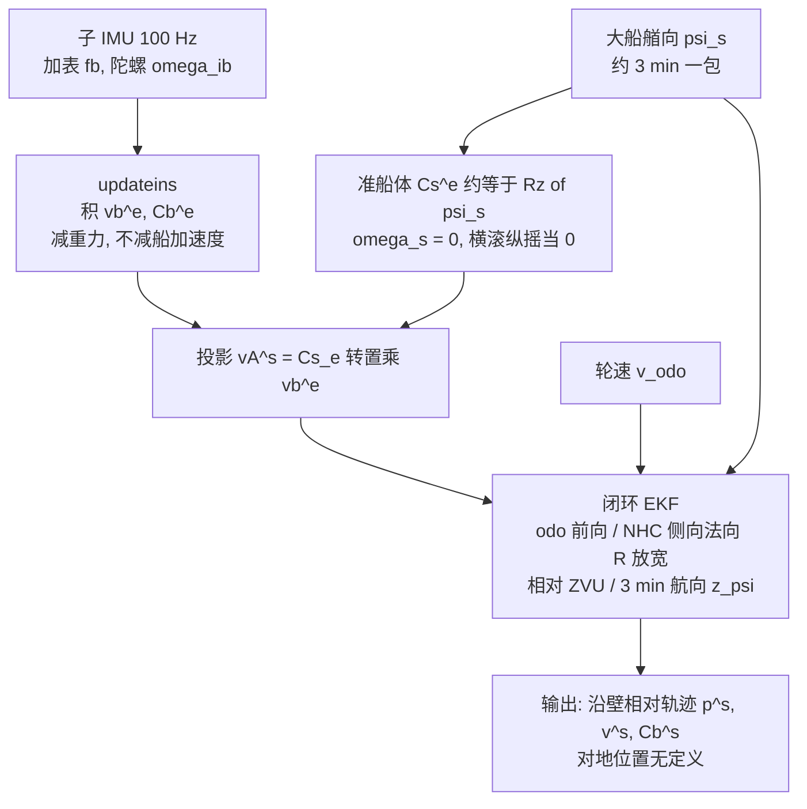
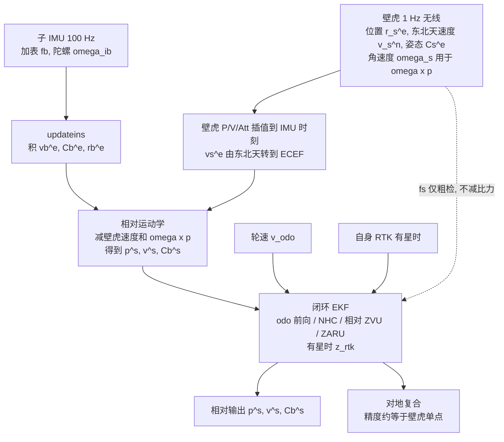

# 船体吸附清洁机器人：相对惯导 / 轮速 / 运动约束设计

本文给出**本工程给清洁机器人用**的 IMU / 轮速 /（可选）RTK 融合设计。壁虎小车是船原点上**已经能出导航解的外部设备**，本仓库不实现壁虎内部滤波。状态与观测建立在**船体相对系**，不沿用陆地 ECEF 下的 `odo()` / `nhc()` / `zvu()`。

配套现状见 [`ins-odo.md`](ins-odo.md)。相关实现：`ins.cc`（机械编排、圆锥/划桨补偿）、`ins-odo.cc`、`ins-nhc.cc`、`ins-zvu.cc`、`ins-zaru.cc`、`tcpostpos.cc` / `carvigsvr.cc`（先 GNSS 再运动约束的序贯更新）。

参考文献：He et al., IEEE/ASME TMech 2025（动地面子 IMU + 母 IMU + 轮速）；Gao et al., TMech 2022（母体位姿速度已知）；本仓库陆地模型 Shin / Groves。

---

## 0. 结论先看

1. **本工程只跑清洁机器人。** 壁虎已 internally 做单点+多普勒+IMU，但**对外无线只有 1 Hz**：位置、东北天速度、姿态、加速度、角速度。清洁机器人做 **RTK + 子 IMU + 轮速**。状态始终在相对系 $p^s,v^s,C_b^s$，对地用壁虎 1 Hz 的 $r_s^e,C_s^e$ 复合。
2. **两种工作模式共用相对运动学形式，加速度计和轮速的用法不同**（公式见第 3.3 节）。
   - **模式 A**：子加表按现有 `updateins` 积对地速度（减重力、不减船加速度）；轮速观测准船体前向速度，$\omega^s=0$。
   - **模式 B**：子加表仍积 $v_b^e$；相对速度用壁虎 1 Hz 的 $v_s^e,C_s^e$ 相减，**不用**壁虎 1 Hz 加速度与子比力相减。轮速观测真正的 $v_{\mathrm{rel}}^b$。
3. **现有 `nhc()` / `zvu()` / `odo()` 不能直接开。** 它们约束的是 $C_e^b v^e$ 和 $v^e\approx 0$。吸附侧壁时 $v^e$ 主要是船速，停车时对地也不为零。
4. **打滑**：本仓库没有滑移状态。侧壁必须加**轮速–IMU 一致性门控**，打滑时丢掉或涨轮速 $R$，NHC 法向仍可用，侧向 NHC 慎用。
5. **多子样 / 划桨**：只对清洁机器人 100 Hz IMU 做现有 `rotscull_corr`。壁虎 1 Hz 的瞬时 $a,\omega$ **不能**和子 IMU 做双端划桨相减，见第 8 节。
6. **无清洁机器人 RTK 时对地：可行，精度≈壁虎 1 Hz 单点（米级）。** 轮速只提高相对船体。1 Hz 链路不改变「对地被单点卡住」这条，但会限制相对捷联能减掉多少船摇。详见第 12 节。

---

## 1. 场景与坐标系

清洁机器人磁轮/履带吸附在大船**侧壁**上行走，易打滑、易短时停车。本工程跑在清洁机器人上：子 IMU + 轮速 + **自身 RTK（有星时）**。壁虎是外部输入。侧壁上自身 RTK 常不可用；对地靠壁虎组合导航与相对量复合（第 12 节）。相对船体位移始终由子 IMU + 轮速 + NHC 估计。

船体本身相对水面/地面会缓慢漂移（流、风、推进）。该漂移是**母体刚体平动+转动**，子体若在壁上静止，相对船体位移应为 0。

| 系 | 符号 | 含义 |
|--|--|--|
| $e$ | ECEF | 壁虎组合导航位置、清洁机器人 RTK、现有 `ins->re` |
| $s$ | 船体，算法内部 | 原点取**壁虎小车 / 船参考点**。本版取前 $x$、右 $y$、下 $z$。艏向冻结指北时与北东地重合 |
| $b$ | 清洁机器人 IMU，算法内部 | 前 $x$、右 $y$、下 $z$。话题 `fog/data` 是前 $x$、上 $y$、右 $z$，进入算法前换成前右下 |
| $r$ | 轮速系 | 默认与 $b$ 重合，杆臂 $l_{br}$ 同现有 `ins->rbl` |
| $g$ | 壁虎 IMU | 模式 B 中与 $s$ 固连，安装角另标定 |
| 输出 | 对外大船坐标 | 右 $x$、前 $y$、上 $z$。只用于 `localization_v2/odometry` 的位置和线速度、`algo/set_position` 的 `position`、控制台 `fusion ship p` |

滤波、轮速和 NHC 都留在算法船体系里，不改状态定义。贴壁法向是几何量，不是本版算法的 $z$ 轴；侧贴横滚约 $90^\circ$ 时，机体系右向才接近地理向下。

对外位置、速度与算法船体系的关系：

$$
p_x^{\mathrm{out}}=p_y^s,\qquad
p_y^{\mathrm{out}}=p_x^s,\qquad
p_z^{\mathrm{out}}=-p_z^s
$$

速度同样。因此沿船艏前进时，对外的 $y$ 增加；向右舷运动时，对外的 $x$ 增加；向上时对外的 $z$ 增加。姿态的欧拉角、四元数和方向余弦仍是算法机体系相对算法船体系，没有改成右前上。

对外的大船位置和经纬高都是**后轮中心**，不是 IMU。杆臂 `lever_fog_to_rear_center` 写在配置里，轴是话题的前、上、右，向量从 FOG 指向后轮中心。算法里先换成前右下 $l^b$，再

$$
p_{\mathrm{rear}}^s = p_{\mathrm{imu}}^s + C_b^s l^b,\qquad
r_{\mathrm{rear}}^e = r_{\mathrm{imu}}^e + C_b^e l^b
$$

$p^{\mathrm{out}}$ 由 $p_{\mathrm{rear}}^s$ 按上一组式子换成右前上。经纬高由 $r_{\mathrm{rear}}^e$ 反算。积分状态、轮速和 NHC 仍在 IMU 上。`algo/set_position` 的 position 和固定锚点经纬高也是后轮中心；N1 这份配置里该杆臂是 0，FOG 与后轮中心重合。

相对位姿（要估的量）：

$$
C_b^s = (C_s^e)^{\mathrm{T}} C_b^e
$$

$$
p^s = (C_s^e)^{\mathrm{T}}(r_b^e-r_s^e)
$$

$$
v^s = \dot{p}^s = (C_s^e)^{\mathrm{T}}(v_b^e-v_s^e)-\omega_{is}^s\times p^s
$$

机体系相对速度：

$$
v_{\mathrm{rel}}^b = C_s^b v^s
$$

**侧壁平面（$n^s$ 和 $d$ 的几何意义）**

贴在船侧壁上时，机器人相对原点的位置落在一张平面上（Hesse 法式）：

$$
n^{s\mathrm{T}} p^s = d
$$

点乘 $n^{s\mathrm{T}}p^s$ 是 $p^s$ 在法向上的投影。上式表示：**从船原点沿壁面法向量到壁面的距离等于 $d$**。切向（沿壁前进、沿壁上下）自由；法向钉死，不能离壁或穿进船壳。

| 符号 | 几何意义 |
|--|--|
| $n^s$ | 壁面**单位法向**，写在船体 $s$ 系，$\lVert n^s\rVert=1$。右舷竖壁 $n^s=e_y^s=[0,1,0]^{\mathrm{T}}$（指向右舷外）；左舷 $n^s=-e_y^s$。不当滤波状态，作业前给定 |
| $d$ | 船原点（壁虎）到该平面的**有向距离**，与 $n^s$ 同向为正。平行中体段近似常值：$d\approx B/2+\delta_{\mathrm{磁}}$（半宽 + 磁轮厚度）。**不是**单独那几厘米吸附间隙；$p^s$ 从原点算起，是半船宽量级 |
| $p^s$ | 清洁机器人相对船原点的位置。右舷 $n^s=e_y^s$ 时 $n^{s\mathrm{T}}p^s=p_y^s$，贴壁则 $p_y^s\approx d$ |

$b$ 系规定 $z$ 指向壁面，故 $n^b=e_z^b$。开工可用安装姿态核对符号：

$$
n^s = C_b^s\, e_z^b
$$

滤波过程中不要每拍用已经在漂的 $C_b^s$ 去改 $n^s$，否则几何约束会跟着姿态误差转。艏艉外飘时 $d$ 随站号变，需型线/CAD；侧壁平行中体用常值即可。模式 A 的 $C_s^e$ 只有艏向，壁仍当竖直，$n^s$ 仍取 $\pm e_y^s$。

观测方程和卡尔曼修正见第 5.3 节。

---

## 2. 与当前工程模型的差异（必须改的）

陆地模型（[`ins-odo.md`](ins-odo.md)）：

$$
v_b = C_e^b v^e
\approx
\begin{bmatrix} v_{\mathrm{fwd}} \\ 0 \\ 0 \end{bmatrix}
$$

停车 ZVU 为 $v^e\approx 0$。`ve2vr` 把 **ECEF 速度**往轮速上拉。船上：

- 轮子停转时 $v_{\mathrm{odo}}=0$，但 $v^e$ 仍是船速 + $\omega_s\times l$；
- NHC 的 $v_{b,y},v_{b,z}$ 对地不为 0；
- `zvu()` 新息是 `ins->ve`，停车吸附时对地仍在动。

相对模型把上述三条全部改到 $v^s$ / $v_{\mathrm{rel}}^b$。软件上建议**新模块**（或 `insopt.hull=1` 分支），不要改坏陆地 `cpt_tc` 路径。

当前调用顺序（`tcpostpos.cc`）可保留：**机械编排 →（可选 GNSS/RTK）→ NHC → odo → 判静 → ZVU/ZARU**。全部观测仍是序贯 EKF，与现工程一致。

| 现代码 | 陆地 | 船体相对（本设计） |
|--|--|--|
| `updateins` | ECEF $C_b^e,v^e,r^e$ | 子 `updateins` + 壁虎 1 Hz 插值得 $p^s,v^s$ |
| `odo()` / `ve2vr` | $\hat{v}^r\leftarrow v^e$ | $\hat{v}^r\leftarrow v_{\mathrm{rel}}^b$（含 $\omega_s\times p$ 与杆臂） |
| `nhc()` | $C_e^b v^e$ 的 $y,z$ | $C_s^b v^s$ 的 $y,z$ |
| `zvu()` | $v^e=0$ | $v^s=0$（相对船体零速） |
| `zaru()` | $\omega_{ib}^b\approx 0$ | $\omega_{sb}^b=\omega_{ib}^b-C_s^b\omega_{is}^s\approx 0$ |
| `detstc` | IMU 对地静 | 须用**相对角速度/相对比力**，或轮速$\approx 0$ |

`insopt.odo` 目前未进 conf，默认关；陆地 `ins-nhc/zvu/zaru` 默认 0。船体模式用独立开关，避免误开陆地约束。

---

## 3. 两种工作模式

框图在 3.1 / 3.2 节开头。两种模式都是子 IMU 捷联 → 相对船体速度 → 轮速/NHC 闭环；差在有没有壁虎把船速减掉。

### 3.1 模式 A — 仅低频大船航向（3 min 一次）

**输入**：清洁机器人 IMU（建议 100 Hz）+ 轮速；大船艏向 $\psi_s$ 约 180 s 一包。无母体 IMU、无原点 RTK。



船摇加速度漏进 `vb^e`，轮速和 NHC 只能当噪声吸收。没有壁虎，不做 $f^b-f^s$。

**能做什么**

- 在壁面上做相对航迹推算：轮速给前进速度，NHC 给侧向/法向，停车相对 ZVU。
- 每 3 min 用 $\psi_s$ 把相对轨迹的**方位**转到当前船体艏向（或修正 $C_b^s$ 的航向通道）。

**不能做什么**

- 没有 $\omega_{is}^s,f^s$，无法按 He 做双 IMU 相对捷联，重力与船体摇摆从子加表里减不干净。
- 没有 $r_s^e$，船体原点随流漂移时，**对地位置无定义**；相对「作业开始时冻结的船体」仍可积位移，但 3 min 内船若转向/横摇，冻结系会偏。
- 横摇/纵摇周期（数秒～十几秒）远快于 3 min，会泄漏为相对位置的低频摆动。

**模式 A 过程模型（单 IMU，准船体系）**

在两次艏向之间，把 $s$ 当作**姿态分段常值**的参考系：只用最近一次 $\psi_s$ 构造水平系 $C_s^e\approx R_z(\psi_s)$（横滚纵摇当 0）。子 **加表 $f^b$** 仍按现有 `updateins` 积 $v_b^e$（减重力，**不减**船加速度），再投影。$\omega^s$ 未知，置 0。**轮速**只观测该准船体前向速度。公式见第 3.3 节。

$$
\hat{v}_A^s = (C_s^e)^{\mathrm{T}} v_b^e
$$

$\omega^s=0$ 是模式 A 的模型误差。NHC/odo 用 $\hat{v}_A^s$。该误差在横摇 $5^\circ/\mathrm{s}$、杆臂 10 m 时可到 $0.9\,\mathrm{m/s}$，**会污染 NHC**。因此模式 A 的 NHC $R$ 必须放宽（见第 5.2 节），法向优先用几何 $n^{s\mathrm{T}}p^s=d$（第 5.3 节）而不是强 NHC。

**3 min 航向观测**

约每 180 s 来一包大船艏向，当作一条航向量测，把准船体 $s$ 系的方位扳到当前船艏向。新息和陆地 `odo()` 里的 $v$ 一样，是量测减预测：

$$
z_\psi = \psi_s - \psi(C_s^e) + \nu_\psi
$$

| 符号 | 含义 |
|--|--|
| $z_\psi$ | 航向新息（残差）。滤波里喂给 `filter()` 的 $v$，不是角速度 |
| $\psi_s$ | 本包**测到的大船艏向**（罗经 / 双天线 GNSS / AIS 等），相对真北或磁北，按数据源约定 |
| $C_s^e$ | 当前正在用的准船体姿态阵。模式 A 两次包之间冻结为 $C_s^e \approx R_z(\psi_{\mathrm{last}})$ |
| $\psi(C_s^e)$ | 从 $C_s^e$ 抽出的航向角，即滤波器**当前认为**的船艏向（上一包留下的值） |
| $\nu_\psi$ | 航向量测噪声（罗经误差、安装偏差、船摇未建模等） |
| $R_\psi$ | $\nu_\psi$ 的方差，取 $(1^\circ\sim 3^\circ)^2$ |

$\psi_s$ 和 $\psi(C_s^e)$ 都是**船相对北的艏向**，不是清洁机器人相对船体的航向。相减得到「船实际转了多少」，用来改 $C_s^e$ 的航向通道，相对轨迹 $p^s$ 跟着转方位。横滚/纵摇模式 A 没有观测，不改。

两次数据包之间没有 $\omega_{is}^s$，航向按随机游走变，不要用过程模型去积船摇。

不要把 $(\psi_{s,k}-\psi_{s,k-1})/180\,\mathrm{s}$ 当成 $\omega_z$ 去补 $\omega\times p$。三分钟平均转速不是瞬时船体角速度，横摇纵摇更没有；硬补会把错误的杆臂速度灌进 NHC/odo。

**模式 A 软件策略**：能出「沿壁走过的相对轨迹」，精度受摇摆泄漏和打滑限制；指标按**时间短、相对位移**验收，不要对标模式 B。

### 3.2 模式 B — 壁虎小车（1 Hz 无线：P/V/Att + $a,\omega$）

壁虎固结在船原点。**内部**已是单点+多普勒+IMU 高频组合，但**对外只有 1 Hz 无线包**，字段为：

- 位置 $r_s^e$（或经纬高，单点米级）
- 东北天速度 $v_s^{n}$（全局水平/天向，多普勒+IMU）
- 姿态 $C_s^e$ 或横滚/纵摇/艏向
- 加速度 $f^s$（或比力，**该秒的一个采样/均值**）
- 角速度 $\omega_{is}^s$（同上）

清洁机器人侧：本工程 **RTK + 100 Hz 子 IMU + 轮速**。有自身 RTK 出全局；无 RTK 出局部并用壁虎 1 Hz 复合对地。见第 12 节。



虚线：壁虎 1 Hz 加速度只做健康检查，不进相对捷联。对地位置听壁虎单点，轮速只提高相对船体。

**输入（按 1 Hz 链路）**

| 数据 | 实际频率 | 用途 | 注意 |
|--|--|--|--|
| 壁虎 $r_s^e$ | 1 Hz | 母体原点、对地复合 | 单点 2–10 m |
| 壁虎 $v_s^{n}$ | 1 Hz | 转成 $v_s^e$ 后算 $v^s$ | 东北天 $\to$ ECEF 用壁虎位置 |
| 壁虎 $C_s^e$ | 1 Hz | $C_b^s$、插值到子 IMU 时刻 | **相对运动学的主输入** |
| 壁虎 $\omega^s,f^s$ | 1 Hz | $\omega\times p$ 粗补偿；**不要**与 100 Hz 子比力相减 | 快变船摇会混叠 |
| 清洁机器人 IMU | 100 Hz | 子姿态、相对积分 | 本机高速率 |
| 清洁机器人 RTK | 1–10 Hz（有星时） | $z_{\mathrm{rtk}}$ | 固定厘米 |
| 轮速 | 滤波 1–10 Hz | 相对前进轴 | 可与壁虎同 1 Hz 对齐 |
| 无线时标 | 必须 | 1 s 量级延迟也要把戳用上 | 无时标则当整秒滞后 |

东北天速度转到 ECEF（与现工程 `ned2xyz` 同类）：

$$
v_s^e = C_n^e(r_s)\, v_s^{n}
$$

**不要做 He 式 100 Hz 双 IMU 相对捷联。** 壁虎 $f^s$ 只有 1 Hz，和子 IMU $f^b$ 相减会把 1 s 台阶灌进 $v^s$。改为 **Gao 风格：母体 P/V/Att 已知、1 Hz 更新，子 IMU 100 Hz**：

1. 把壁虎 $C_s,v_s,r_s$ **插值**到当前子 IMU 时刻（姿态球面插值，速度/位置线性或用 $v_s$ 外推）。无新包时用上一包外推：$\hat r_s\leftarrow \hat r_s+v_s\Delta t$。
2. 子 IMU 仍走现有 `updateins`（ECEF，$C_b^e,v_b^e$），或只积姿态。
3. 相对量由定义计算（当量测或当状态）：

$$
C_b^s = (C_s^e)^{\mathrm{T}} C_b^e
$$

$$
p^s = (C_s^e)^{\mathrm{T}}(r_b^e-r_s^e)
$$

$$
v^s = (C_s^e)^{\mathrm{T}}(v_b^e-v_s^e)-\omega_{is}^s\times p^s
$$

$\omega_{is}^s$ 优先用 **相邻 1 Hz 姿态差的平均角速度**（比该秒一个瞬时 $\omega$ 采样更稳），再用于 $\omega\times p$ 和 NHC 的 $H_p$。**子加表 $f^b$** 只出现在 $v_b^e$ 的捷联里；**壁虎 1 Hz 加速度**仅作粗检，不进相对比力方程。**轮速**观测已减 $v_s$ 后的 $v_{\mathrm{rel},x}^b$。公式见第 3.3 节。

闭路 EKF 仍估 $\delta\phi,\delta v^s,\delta p^s,\delta b_a^b,\delta b_g^b,\delta s$。壁虎量当已知输入，其 1 Hz 量化/插值误差放进 $Q$ 和 NHC/odo 的 $R$（比高频母 IMU 方案放宽）。

**1 Hz 相对船体还行不行（量级）**

海浪横摇周期多在 6–15 s，1 Hz 对姿态/速度 **够奈奎斯特**。清洁机器人爬壁很慢，两次壁虎包之间轮速仍可积 $p^s$。额外误差主要是：

- 插值/延迟：船在 1 s 内姿态变 $0.3^\circ$–$1^\circ$ 时，相对投影误差约 $|p|\delta\phi$，20 m 杆臂约 **0.1–0.3 m/s 等效速度**，应进 NHC $R$；
- $>0.5\,\mathrm{Hz}$ 的砰击、甲板振动：壁虎包里没有，会漏进相对；
- 无线晚 0.2–1 s：必须用报文时间戳，否则 $\omega\times p$ 和 $v_s$ 会系统偏。

相对作业（扫船壳）**仍然可行**，比 50–100 Hz 母 IMU 差，但远好于模式 A。对地仍被壁虎单点限制，见第 12 节。

船体对地漂移：壁虎 1 Hz 位置跟踪 $r_s^e$（单点），$p^s$ 不包含船漂。

加速度计、轮速在 A/B 中如何进公式，集中写在第 3.3 节。

---

## 3.3 加速度计与轮速：模式 A / B 公式对照

清洁机器人上两路本机传感器：加表 $f^b$（`imu->accl`，100 Hz）和轮速 $v_{\mathrm{odo}}$（脉冲积分，滤波 1–10 Hz）。二者都不是对地速度计。差别只在相对速度里有没有把船的运动减掉。

| 量 | 模式 A（仅 3 min 船航向） | 模式 B（壁虎 1 Hz P/V/Att） |
|--|--|--|
| 子加表 $f^b$ | 进 `updateins`，积 $v_b^e,C_b^e$ | 同样进 `updateins` |
| 壁虎加表 $f^s$ | 无 | 不进相对速度，仅 1 Hz 粗检 |
| 轮速 | 观测 $\hat{v}_A^s$ 的前向 | 观测 $v^s$ 的前向 |
| 船加速度 | 漏进 $v_b^e$，轮速/NHC 当噪声 | 由壁虎 $v_s^e$ 吸收，不靠 $f^s$ |

### 3.3.1 加速度计（过程）

现工程 `updateins`（`ins.cc`）在 ECEF 里用比力积速度（已含 `rotscull_corr`、减 $b_a$、加重力与柯氏项）。两种模式都保留这一步，不要改成只用轮速航迹推算。

$$
\dot{v}_b^e = C_b^e(f^b-b_a^b) + g^e - 2\,\omega_{ie}^e\times v_b^e
$$

$$
\dot{r}_b^e = v_b^e
$$

**模式 A** 没有 $v_s^e$、$\omega_{is}^s$、$f^s$。相对速度只能把上面积出来的 $v_b^e$ 投到仅有艏向的准船体，$\omega_{is}^s$ 取 0：

$$
C_s^e \approx R_z(\psi_s)
$$

$$
\hat{v}_A^s = (C_s^e)^{\mathrm{T}} v_b^e
$$

船的比力（横摇、纵荡）仍在 $f^b$ 里，会进入 $\dot{v}_b^e$，从而进入 $\hat{v}_A^s$。轮速无法把这项从过程里消掉，只能在观测里当模型误差（放大 $R$）。

**模式 B** 同样用 $f^b$ 积 $v_b^e$，相对速度用壁虎导航解相减（不是 $f^b-f^s$）：

$$
v_s^e = C_n^e(r_s)\, v_s^{n}
$$

$$
p^s = (C_s^e)^{\mathrm{T}}(r_b^e-r_s^e)
$$

$$
v^s = (C_s^e)^{\mathrm{T}}(v_b^e-v_s^e)-\omega_{is}^s\times p^s
$$

子加表只出现在 $v_b^e$ 里。壁虎 1 Hz 加速度 $f^s$ 不出现在上式。$v_s^e$ 已是壁虎内部用自己的加表和多普勒积过的速度。不要写成 He 的 $\dot{v}^s = C_b^s f^b - f^s$，在 1 Hz 下不成立。

加表在观测里还做两件辅助事（A/B 相同，阈值不同）：

- 打滑门控：轮速有脉冲而机体系前向比力接近 0（空转），见第 6 节
- 模式 B 停车粗检：$C_b^s f^b$ 与 1 Hz 的 $f^s$ 是否接近（弱）；模式 A 无 $f^s$，只用轮速和子陀螺判相对静

### 3.3.2 轮速（量测）

轮速始终是相对壁面的前向速度。脉冲变成速度仍用 [`ins-odo.md`](ins-odo.md) 第 3 节：

$$
v_{\mathrm{odo}} = \frac{\sum\Delta r}{\sum\Delta t}
$$

预测轮速的写法与陆地 `ve2vr` 相同，只是把 $C_e^b v^e$ 换成相对速度，地球自转换成船体角速度。

**模式 A**（$\omega_{is}^s=0$，$\hat{v}^s=\hat{v}_A^s$）：

$$
v_b^{\mathrm{odo}} = C_s^b\, \hat{v}_A^s + \bigl[\omega_{ib}^b\bigr]\times l_{br}
$$

$$
\hat{v}^r = (1+s)\,C_b^r\, v_b^{\mathrm{odo}}
$$

$$
v = v_{\mathrm{odo}} - \hat{v}_x^r
$$

单轴时只用前向。用加表积出的 $v_b^e$ 投到准船体，再和轮速比。船在摇时 $\hat{v}_A^s$ 含船速泄漏，新息会偏，故 $R$ 要大于模式 B。

**模式 B：**

$$
v_b^{\mathrm{odo}} = C_s^b\, v^s + \bigl[\omega_{ib}^b - C_s^b\,\omega_{is}^s\bigr]\times l_{br}
$$

$$
\hat{v}^r = (1+s)\,C_b^r\, v_b^{\mathrm{odo}}
$$

$$
v = v_{\mathrm{odo}} - \hat{v}_x^r
$$

其中 $v^s$ 已减壁虎 $v_s^e$ 和 $\omega_{is}^s\times p^s$。轮速钉的是相对船走多快，加表钉的是对地惯性速度，二者通过 $v_b^e-v_s^e$ 接到一起。

模式 A 相当于上式里 $v_s^e=0$、$\omega_{is}^s=0$、$C_s^e=R_z(\psi_s)$。

### 3.3.3 和 NHC 怎么分工

加表积分给出三维 $v_b^e$。轮速只约束前向相对速度；NHC 约束侧向/法向（第 5.2 节）。模式 A 用 $\hat{v}_A^s$ 代替 $v^s$。

$$
v_{\mathrm{rel}}^b = C_s^b v^s
$$

$$
v_{\mathrm{rel},y}^b = 0,\qquad v_{\mathrm{rel},z}^b = 0
$$

$$
v = v_{\mathrm{rel},x}^b - v_{\mathrm{odo}}
$$

停车时相对 ZVU 把三轴 $v^s$ 拉到 0，此时轮速应为 0，加表不应再积出相对加速。

---

## 4. 误差状态方程

与现工程一致：姿态在前（`xiA=0`），速度、位置、加表/陀螺零偏（`xiV/xiP/xiBa/xiBg`）。轮速比例因子改为 **5 维**，每个轮子一个，不再共用一个 $s$。顺序与轮速投影相同：大轮右、左、前，小轮右、左。

### 4.1 模式 B 推荐状态

$$
x =
\begin{bmatrix}
\delta\phi^s \\
\delta v^s \\
\delta p^s \\
\delta b_a^b \\
\delta b_g^b \\
\delta s_{1:5}
\end{bmatrix}
,\qquad
\delta s_{1:5}=
\begin{bmatrix}
\delta s_{\mathrm{mr}}\\
\delta s_{\mathrm{ml}}\\
\delta s_{\mathrm{mf}}\\
\delta s_{\mathrm{sr}}\\
\delta s_{\mathrm{sl}}
\end{bmatrix}
$$

共 20 维。$\delta\phi^s$：$C_b^s$ 的右扰动（与现 `corratt` 同类）。壁虎 IMU 若已是组合导航输出，**不估** $b_a^s,b_g^s$，把壁虎当已知输入，噪声进 $Q$。五个比例因子的过程互不耦合，各自 $\delta\dot s_i=w_{s,i}$。模式 B 的五轮更新本版尚未接入。

线性化（确定性相对运动，忽略地球自转）：

$$
\delta\dot{\phi} \approx -[\omega_{is}^s]_{\times}\delta\phi - C_b^s\delta b_g^b + w_\phi
$$

$$
\delta\dot{v}^s \approx -[\omega_{is}^s]_{\times}\delta v^s - [C_b^s f^b]_{\times}\delta\phi + C_b^s\delta b_a^b + w_v
$$

$$
\delta\dot{p}^s \approx -[\omega_{is}^s]_{\times}\delta p^s + \delta v^s
$$

$$
\delta\dot{b}_a = -b_a/\tau_a + w_{ba},\qquad
\delta\dot{b}_g = -b_g/\tau_g + w_{bg},\qquad
\delta\dot{s}_i = w_{s,i}\quad(i=1\ldots 5)
$$

五个比例因子互不耦合，各自一条随机游走。

$\Phi,Q$ 按现有 `stochasticPhi` / `getQ` 同样结构生成，陀螺/加表 PSD 换成子 IMU 档（十几万 FOG 则不要用 `cpt_tc` 里 ARW $\approx 0.2^\circ/\sqrt{\mathrm{h}}$ 那套）。

### 4.2 模式 A 状态

同一套 20 维 $x$，过程里 $\omega_{is}^s=0$。$\delta\phi$ 与第 5.1 节相同，是 $C_b^s$ 的右扰动 $\delta\phi^b$：$C_b^s\leftarrow C_b^s(I+[\delta\phi\times])$。于是

$$
\delta\dot{\phi}^b=-\delta b_g,\qquad
\delta\dot{v}^s=-C_b^s[f^b]_{\times}\delta\phi^b-C_b^s\delta b_a,\qquad
\delta\dot{p}=\delta v
$$

若把姿态误差定义成船体坐标 $\delta\phi^s=C_b^s\delta\phi^b$，姿态项才变成 $\delta\dot\phi^s=-C_b^s\delta b_g$、$\delta\dot v^s=-[f^s]_{\times}\delta\phi^s$。加表项仍是 $-C_b^s\delta b_a$：积分先减 $b_a$，反馈再把 $\delta b_a$ 加回去。闭环是右乘 $C_b^e$，存的必须是 $\delta\phi^b$。侧贴时 $C_b^s$ 远离单位阵，两套混用会把姿态往错误的轴上纠。

零偏和五个比例因子在 $\Phi$ 里保持不变，只靠对角 $Q$。子加表仍按 $\dot v_b^e = C_b^e(f^b-b_a)+g^e-\cdots$ 积分；相对速度误差多一项未建模的船加速度：

$$
\delta\dot{v}_A^s \approx (C_s^e)^{\mathrm{T}}\delta v_b^e + w_{\mathrm{ship}}
$$

$w_{\mathrm{ship}}$ 是船加速度 $a_{\mathrm{ship}}^e$ 无法从 $v_b^e$ 减去、投影进 $\hat{v}_A^s$ 的项（横摇/纵荡），须加大 $Q_v$。本版速度过程噪声取 $0.05\,\mathrm{m/s}^2$（已盖住传感器约 $0.01\,\mathrm{m/s}^2$ 的白噪声）。陀螺角随机游走取仿真 FOG 的 $0.01^\circ/\sqrt{\mathrm{h}}$。加表零偏、陀螺零偏、比例因子用小随机游走，功率谱密度分别为 $10^{-8}\,(\mathrm{m/s}^2)^2/\mathrm{s}$、$10^{-12}\,(\mathrm{rad/s})^2/\mathrm{s}$、$10^{-8}/\mathrm{s}$。离散传播取 $\Phi\approx I+F\Delta t$，每个 IMU 步做 $P\leftarrow\Phi P\Phi^{\mathrm{T}}+Q$。对角过程噪声是上述功率谱密度乘 $\Delta t$；姿态通道用角随机游走的平方乘 $\Delta t$。

设位时 $P$ 的对角初值：姿态 $(5^\circ)^2$，速度 $(0.5\,\mathrm{m/s})^2$，位置 $(1\,\mathrm{m})^2$，加表零偏 $(0.05\,\mathrm{m/s}^2)^2$，陀螺零偏 $(10^{-3}\,\mathrm{rad/s})^2$，每个比例因子 $0.05^2$。轮速观测用下面第 5.1 节的五维式，不再用单一前向新息。积分用的陀螺和加表先减去已估计零偏。

### 4.3 可选：滑移状态

本仓库没有滑移率。侧壁打滑频繁时，建议**先用门控**（第 6 节），不要一上来加状态。若门控不够，再增一维前向滑移 $\kappa$：

$$
v_{\mathrm{odo}} = (1-\kappa)\,v_{\mathrm{rel},x}^b
$$

$$
\dot{\kappa} = -\kappa/\tau_\kappa + w_\kappa
$$

仅当一致性检测触发时让 $\kappa$ 吸收，平时 $\kappa\approx 0$。

---

## 5. 观测方程

符号：新息 $z = z_{\mathrm{meas}}-\hat{z}$，与现 `filter(x,P,H,v,R)` 的 $v$ 同向（陆地 odo 为 $v_{\mathrm{odo}}-\hat{v}$）。

### 5.1 轮速（替代 `ve2vr`）

完整展开见第 3.3.2 节。滤波新息与陆地 `odo()` 同形，$v_b^e$ 都由子加表捷联得到。

**模式 A**（$\omega_{is}^s=0$，$\hat{v}_A^s=(C_s^e)^{\mathrm{T}} v_b^e$）

$$
v_b^{\mathrm{odo}} = C_s^b\, \hat{v}_A^s + \bigl[\omega_{ib}^b\bigr]\times l_{br}
$$

**模式 B**

$$
v^s=(C_s^e)^{\mathrm{T}}(v_b^e-v_s^e)-\omega_{is}^s\times p^s
$$

$$
v_b^{\mathrm{odo}} = C_s^b\, v^s + \bigl[\omega_{ib}^b - C_s^b\,\omega_{is}^s\bigr]\times l_{br}
$$

两种模式：

$$
\hat{v}^r = (1+s)\,C_b^r\, v_b^{\mathrm{odo}}
$$

$$
v = v_{\mathrm{odo}} - \hat{v}_x^r
$$

$H$ 对 $\delta v^s,\delta\phi,\delta b_g,\delta s,\delta l$ 的结构与 `jacobian_ov_*` 相同：模式 A 把 $C_e^b v^e$ 换成 $C_s^b\hat{v}_A^s$，模式 B 换成 $C_s^b v^s$。$v_s^e$ 仅模式 B 来自壁虎东北天速度。

- 默认只融前向（`odopt.all=0`）。
- $R$ 不要写死 `VARVEL=0.1^2`：正常 $0.05\sim 0.15\,\mathrm{m/s}$；疑似打滑涨到 $0.5\sim 2\,\mathrm{m/s}$ 或直接跳过。
- 平滑窗口仍可用 `ins-odo_odt`（0.2–0.5 s，侧壁比陆地车慢，可略短）。
- **大相对横摆**放弃本次更新：用 $\lVert\omega_{sb}^b\rVert$ 而不是 $\lVert\omega_{ib}^b\rVert$（模式 B 船体在摇时子陀螺并不小）。门槛可先沿用 $30^\circ/\mathrm{s}$，侧壁建议降到 $15\sim 20^\circ/\mathrm{s}$。

**模式 A 五轮实现（本版已接入）**

本版融合左右大轮和左右小轮，前轮不融合。每一对都是左右先平均，再用该对轮心中点到 IMU 的杆臂补到 FOG。角速度用话题陀螺，先从前-上-右换成前-右-下。杆臂是配置里的前-上-右：先取 fog 到后轮中心，再加上这一对 `rear_to_wheel` 的中点，然后换成前-右-下。杆臂只留在量测里，不进 $H$：

$$
v_{\mathrm{axle}}=\frac{v_r+v_l}{2},\qquad
l^b=l_{\mathrm{fog}\rightarrow\mathrm{rear}}^b+\frac{l_r^b+l_l^b}{2}
$$

$$
v_{\mathrm{fog}}^b=(v_{\mathrm{axle}},\,0,\,0)-\omega^b\times l^b
$$

N1 上后轮轴中心与 FOG 重合，平均后的杆臂是 0。小轮中点在前-上-右 $(0,-0.075,0)$，前-右-下为 $(0,0,0.075)$。大轮和小轮这两条都送进滤波，前轮不融合。

观测向量仍是五维。第 0 行是大轮轴中心，第 3 行是小轮轴中心。左轮、前轮和另一条小轮行的 $H$ 与新息都是 0：

$$
z_0=v_{\mathrm{fog},x}^{\mathrm{rear}},\qquad
z_3=v_{\mathrm{fog},x}^{\mathrm{small}},\qquad
\hat z_0=\Bigl(1+\frac{s_0+s_1}{2}\Bigr)\,v_{\mathrm{rel},x}^b,\qquad
\hat z_3=\Bigl(1+\frac{s_3+s_4}{2}\Bigr)\,v_{\mathrm{rel},x}^b
$$

$$
v_{\mathrm{rel}}^b=C_s^b v^s,\qquad
\nu=z-\hat z
$$

状态仍是 20 维，下标不变：大轮右、左、前，小轮右、左。前轮比例因子留着但没有观测。大轮 $R=(0.1\,\mathrm{m/s})^2$，小轮 $R=(0.05\,\mathrm{m/s})^2$。里程仍按 50 Hz 把相邻帧差分成速度，滤波只用最新的这一组速度，不做平均。融合频率由 `config/localization_v2.yaml` 的 `wheel_fusion_hz` 决定，当前是 50 Hz。更新是 $x\leftarrow x+K(z-\hat z)$，$H=\partial\hat z/\partial x$，与 `rtkcmn.cc` 里 `filter()` 的 $v=$ 量测减预测、$x+Kv$ 同号。非完整性约束见第 5.2 节，频率由 `nhc_hz` 决定，当前是 100 Hz。

$H$ 为 $5\times 20$。位置、加表零偏、陀螺零偏列为 0。两行的速度列都是 $(1+\bar s)\,e_x^{\mathrm{T}}C_s^b$，比例因子为 0 时这两行速度列相同。姿态三列本版写成 0，轮速不改航向，左右轮差速也不做航向修正。大轮 $\bar s=(s_0+s_1)/2$，小轮 $\bar s=(s_3+s_4)/2$。大轮比例因子列在第 15、16 列各写 $v_x/2$，小轮在第 18、19 列也各写同一个 $v_x/2$，这个 $v_x/2$ 不再乘 $(1+\bar s)$。其余三行整行是 0。

闭环后误差清零：$\delta\phi^b$ 右乘 $C_b^e$（$C_s^e$ 冻结时即改 $C_b^s$），$\delta v^s,\delta p^s$ 经 $C_s^e$ 加进 $v^e,r^e$，零偏和比例因子累加到估计值。贴壁平面、艏向和 ZVU 本版不进这次更新。模式 A 的 NHC 见第 5.2 节，在轮速更新之外按 `nhc_hz` 单独做，当前是 100 Hz。模式 B 仍沿用上面的单轴公式，五轮 $H$ 尚未接入。

### 5.2 非完整性约束 NHC

吸附 + 非完整轮：

$$
v_{\mathrm{rel},y}^b = 0,\qquad v_{\mathrm{rel},z}^b = 0
$$

这是两条 **虚速度观测**。本版侧向是后轮中心的机体系右向速度，法向仍是 IMU 点的机体系下向速度。新息：

$$
z_{\mathrm{NHC}}
=
\begin{bmatrix} e_2^{\mathrm{T}} C_s^b v^s \\ e_3^{\mathrm{T}} C_s^b v^s \end{bmatrix}
-
\begin{bmatrix} 0 \\ 0 \end{bmatrix}
$$

姿态已知或已在状态里时，对 $v^s$ 的雅可比：

$$
H_v
=
\begin{bmatrix} e_2^{\mathrm{T}} C_s^b \\ e_3^{\mathrm{T}} C_s^b \end{bmatrix}
$$

对 $p^s$ 还有（来自 $v^s$ 定义中的 $\omega\times p$；模式 A 的 $\omega=0$ 则无此项）：

$$
H_p
=
\begin{bmatrix}
e_2^{\mathrm{T}} C_s^b[\omega_{is}^s]_{\times} \\
e_3^{\mathrm{T}} C_s^b[\omega_{is}^s]_{\times}
\end{bmatrix}
$$

法向**位置**不要和这里的 $z$ 轴速度观测混成一条，见第 5.3 节。全向/可横移机构：**不要**做 $v_y^b=0$，只留第 5.3 节几何。

**门控（相对陆地 `bldnhc` 的改写）**

对 $y$、$z$ 分别判断，不满足就 **跳过这一轴**：

$$
|v_{\mathrm{rel},i}^b| > 0.2\sim 0.3\,\mathrm{m/s}
\quad\text{或}\quad
\lVert\omega_{sb}^b\rVert \text{过大}
$$

陆地门槛是 $0.5\,\mathrm{m/s}$；侧壁更严。真实侧滑/掉磁时硬拉会毁轨迹。模式 A：法向 NHC 的 $R$ 放到 $0.2\sim 0.5\,\mathrm{m/s}$，避免把横摇泄漏当成离壁。

本版模式 A 代码里，速度门 $|v_{\mathrm{rel},i}^b|>0.3\,\mathrm{m/s}$ 和角速度门 $\lVert\omega_{ib}^b\rVert>20^\circ/\mathrm{s}$ 都已屏蔽。上面的门槛留作设计，当前不执行。

**频率**：与现工程相同，**不要跟 IMU 同频**。`nhz` 按拍数降频：100 Hz IMU 用 `nhz=10`～`20`（约 5–10 Hz）或 `nhz=100`（约 1 Hz）。FOG 用 1 Hz 足够；侧壁微振可 5–10 Hz。同频且 $R$ 仍 $0.05^2$ 会过约束（虚测量时间相关）。

陆地 NHC 默认约 1 Hz（`ins-hz=100`、`ins-nhz=100`）。壁虎也是 1 Hz 时，**NHC 对齐壁虎包（约 1 Hz）最合适**，不要为 1 Hz 母体再把 NHC 加到 10 Hz。

**模式 A 实现（本版已接入）**

每个 IMU 步做完捷联后，侧向和法向按 `nhc_hz` 一起更新，当前是 100 Hz。模式 A 的 $\omega_{is}^s=0$，所以 $H_p=0$，也不做 $\omega\times p$。量测是 0。侧向预测用后轮中心速度，法向预测仍用 IMU 速度：

$$
h_y=e_y^{\mathrm{T}}(v_{\mathrm{imu}}^b+\omega^b\times l^b),\qquad
h_z=v_{\mathrm{imu},z}^b,\qquad
z=0,\qquad
\nu=z-h
$$

$l^b$ 是 FOG 到后轮中心，配置为前-上-右，用前换成前-右-下。$\omega^b$ 是已经减过陀螺零偏的机体系角速度。$l^b=0$ 时侧向与直接约束 IMU 相同。

两轴序贯更新，仍是 $x\leftarrow x+K\nu$。速度列就是 $e_2^{\mathrm{T}}C_s^b$、$e_3^{\mathrm{T}}C_s^b$，只对 $v_{\mathrm{imu}}^b$ 求导。侧向和法向的姿态三列本版都写成 0，只拉速度，不改航向和纵摇。$\omega^b$ 和 $l^b$ 都在机体系，姿态误差不进 $\omega\times l$。反馈把修正加进陀螺零偏，所以侧向对 $\delta b_g$ 的列是 $[l^b\times]$ 的右向行 $(l_z,\,0,\,-l_x)$。法向的陀螺零偏列仍是 0。位置、加表零偏、五个比例因子列为 0。

侧向 $R=(0.02\,\mathrm{m/s})^2$，法向 $R=(0.3\,\mathrm{m/s})^2$。$|v_{\mathrm{rel},i}^b|>0.3\,\mathrm{m/s}$ 跳过该轴、以及补偿陀螺零偏后 $\lVert\omega_{ib}^b\rVert>20^\circ/\mathrm{s}$ 两轴都跳过，这两道门本版已屏蔽。后轮中心右向速度和 IMU 下向速度按 `nhc_hz` 更新，当前是每 0.01 s。`SurfaceTight` 时和轮速一起停。贴壁几何、ZVU 仍不在这次更新里。

### 5.3 法向几何的卡尔曼修正

几何意义见第 1 节。这是一条**位置**虚测量，不增加状态。闭环 EKF 与陆地 `odo()` 相同：预测后 $x=0$，用 `filter(x,P,H,v,R,nx,nv)` 得到 $\delta x$，再按 `clp()` 反馈。

**新息**

量测是「应在平面上」，预测是当前 $p^s$ 在法向上的投影：

$$
v = n^{s\mathrm{T}} p^s - d
$$

$v>0$：比壁面更靠法向外侧（离壁或半宽估大了）；$v<0$：穿进船壳。和陆地 odo 的 $v_{\mathrm{odo}}-\hat{v}$ 一样，是量测减预测的符号约定下「预测偏了多少」。

**雅可比**

状态顺序与第 4.1 节相同。$n^s$、$d$ 当作已知常数，不进 $x$。只有位置列非零：

$$
H = \bigl[0_{1\times 3}\ \ 0_{1\times 3}\ \ n^{s\mathrm{T}}\ \ 0\ \cdots\bigr]
$$

即 $\partial v/\partial(\delta p^s)=n^{s\mathrm{T}}$，对 $\delta\phi^s,\delta v^s,\delta b_a,\delta b_g,\delta s$ 为 0。因此这次更新**直接改的是 $p^s$ 的法向分量**；沿壁前进、沿壁上下（切向）$H$ 为 0，本条观测拉不动。速度、姿态只在 $P$ 里与位置相关时被间接拧一点。

**增益与反馈**

$$
K = P H^{\mathrm{T}}(H P H^{\mathrm{T}}+R)^{-1}
$$

$$
\delta x = K v
$$

$$
P \leftarrow (I-K H)P
$$

与现工程 `clp()` 一样，位置减误差：

$$
p^s \leftarrow p^s - \delta p^s
$$

右舷 $n^s=e_y^s$ 时，$\delta p_y^s$ 把 $p_y^s$ 往 $d$ 拉。切向 $p_x^s,p_z^s$ 本条 $H$ 为 0，保持惯导积分（再靠轮速/NHC）。

**观测噪声**

$R$ 是标量。壁面当平面、半宽准：$R=(0.05\sim 0.15\,\mathrm{m})^2$。型线不准或模式 A 壁并不竖直：放到 $(0.2\sim 0.5\,\mathrm{m})^2$。$|v|$ 过大（明显掉磁）跳过本次，见第 6 节。

**和 NHC 的分工**

| | 第 5.2 节 NHC $z$ | 本节几何 |
|--|--|--|
| 钉什么 | $v_{\mathrm{rel},z}^b\approx 0$ | $n^{s\mathrm{T}}p^s=d$ |
| $H$ 主要列 | 速度 | 位置 |
| 模式 A | 船摇假速度会污染，须放宽 $R$ | 不直接吃那项假速度，优先用 |

建议模式 B 必加；模式 A 法向用本节、NHC 法向降权。频率不要跟 IMU 同频，可与 NHC 同拍（约 1 Hz）。

### 5.4 相对零速 ZVU（替代 `zvu()`）

机器人相对船体停车（吸附不动）：

$$
z_{\mathrm{ZVU}} = v^s
$$

$H$ 填速度列：$I_3$。**禁止**使用 `ins->ve`。壁虎和船仍在摇，对地速度不是 0。

判静不能只用子 IMU 的 `detstc`（对地比力含船摇）。应用：

1. 轮速 $|v_{\mathrm{odo}}|<\varepsilon$（现有 `detstatic_ODO` 思路），且
2. 相对角速度 $\lVert\omega_{sb}^b\rVert$ 小，且
3. 相对比力 $C_b^s f^b-f^s$ 接近 0（壁虎 $f^s$ 仅 1 Hz，此项很弱，模式 B 只能作粗检）。

模式 A 只做 1 + 「子陀螺在船体摇摆频段之外的高频能量小」，虚警会多于模式 B；$R$ 放宽到 $0.1\sim 0.2\,\mathrm{m/s}$。

次数门限可沿用 `MINZC=15` 一类，避免每拍都 ZVU。

### 5.5 相对零角速度 ZARU

$$
z_{\mathrm{ZARU}} = \omega_{ib}^b - C_s^b\omega_{is}^s
$$

模式 A 无 $\omega^s$，ZARU 只能在确认相对静且船也不怎么转时用子陀螺 $\approx 0$，**不可靠，建议模式 A 关闭**。模式 B 停车时开，估 $b_g^b$。

### 5.6 清洁机器人 RTK 与壁虎位置（模式 B）

壁虎 $r_s^e$ **不是**清洁机器人的 RTK，只是母体原点（单点）。相对滤波把壁虎 $C_s^e,r_s^e,\omega^s,f^s$ 当输入，不必把壁虎位置写成子体 $z$。

清洁机器人**自身 RTK** 有星时（甲板、空旷），作为全局/相对位置观测：

$$
z_{\mathrm{rtk}} = (C_s^e)^{\mathrm{T}}(r_{b,\mathrm{rtk}}^e-r_s^e) - p^s
$$

或等价地约束复合后的 $r_b^e$。$R$ 按固定/浮点/单点设。侧壁无星时关掉该观测，只留轮速+NHC。无自身 RTK 时对地复合的精度见第 12 节。

### 5.7 大船航向（模式 A 主用，模式 B 可选备份）

符号与新息见第 3.1 节。模式 B 用壁虎组合导航姿态，不必等 3 min 船艏向。

---

## 6. 打滑：门控优先于状态

现工程（[`ins-odo.md`](ins-odo.md) 第 8 节）：无滑移状态；仅 $\lVert\omega\rVert>30^\circ/\mathrm{s}$ 丢 odo/NHC，$|v_{b,i}|>0.5$ 丢该轴 NHC。侧壁磁轮打滑**经常发生在直行、角速度不大**时，现逻辑会把虚高轮速当真速度。

**推荐检测（每轮速更新拍）**

1. **纵向**：$|v_{\mathrm{odo}}-\hat{v}_x^b| > \gamma_v$（$\gamma_v$ 先取 $0.15$–$0.3\,\mathrm{m/s}$），或编码器有脉冲而相对比力前向接近 0（空转）。
2. **航向**：差速/履带 $\Delta\theta_{\mathrm{enc}}$ 与 $\int\omega_{sb,z}\,\mathrm{d}t$ 不一致（Appl. Sci. 2025 清洗机器人同思路）→ 判侧滑，**航向信 IMU，丢掉轮速航向信息**（本设计轮速本就只融前向）。
3. **法向**：$|n^{s\mathrm{T}}v^s|$ 大或 $n^{s\mathrm{T}}p^s$ 偏离 $d$ → 疑似掉磁，全约束降权，只靠 IMU 短时。

**动作**

| 判定 | 轮速 | NHC $y$ | NHC $z$ / 几何法向 | ZVU |
|--|--|--|--|--|
| 正常 | 融，$R$ 正常 | 融 | 融 | 仅停车 |
| 纵向打滑 | 跳过或 $R\times 10\sim 100$ | 仍可融 | 融 | 不因轮速判静 |
| 侧滑 | 跳过 | **跳过** | 融 | 否 |
| 掉磁 | 跳过 | 跳过 | 跳过几何，IMU only | 否 |
| 相对静止 | 可作辅助判静 | 可关 | 可关 | **开** $v^s=0$ |

打滑期间前进轴退回纯相对惯导（模式 B 有母 IMU，1 min 仍可能数米；模式 A 更快散）。作业流程上应**打滑即停、相对 ZVU 钉住**，不要指望边滑边定位。

---

## 7. 观测使用策略与节拍

与 `tcpostpos` 相同的序贯结构（船体模式）：

```text
每个子 IMU 历元：
  1. 模式 B：子 IMU `updateins`；壁虎 1 Hz 包插值 $C_s,v_s,r_s$ → 相对 $p^s,v^s$
     模式 A：updateins（准 s 系）
  2. 模式 B：有清洁机器人 RTK 则做 $z_{\mathrm{rtk}}$
     模式 A：若有 3 min 航向 → 航向更新
  3. 相对 NHC（降频 1–10 Hz）
  4. 法向几何 n^T p = d（第 5.3 节）
  5. 轮速 odo（攒够 odt；打滑门控）
  6. 相对判静 → 相对 ZVU / 模式 B 的 ZARU
```

| 模块 | 模式 A | 模式 B |
|--|--|--|
| 相对捷联 | 弱（无母 IMU） | 子 100 Hz + 壁虎 1 Hz 插值，**无比力相减** |
| 母体 $\omega,f$ | 无 | **1 Hz**，只用于 $\omega\times p$ / 粗检 |
| 母体 RTK | 无 | 无（壁虎是单点+多普勒+IMU） |
| 清洁机器人 RTK | 无 | 有星时 1–10 Hz |
| 母体组合导航 P/V/Att | 无 | **1 Hz 无线** |
| 船航向 | 1/180 Hz | 不需要 |
| NHC | 1 Hz，$R$ 大 | 1–10 Hz |
| 法向几何 | 弱约束 | 1–10 Hz |
| 轮速 | 1–10 Hz + 打滑门控 | 同左 |
| 相对 ZVU | 谨慎，$R$ 大 | 停车必开 |
| ZARU | 关 | 停车开 |

**同时融合，不是 GNSS 差了再切轮速。** 清洁机器人 RTK、壁虎组合导航、轮速能用的一起用，靠 $R$ 加权。有自身 RTK 时全局位置主要听 RTK；无 RTK 时相对靠轮速+NHC，对地靠壁虎单点复合（第 12 节）。

两轴误差：NHC + 法向几何会**显著压住侧向和法向速度/位移发散**；前进轴无轮速或打滑丢掉轮速后仍按 $\tfrac12 b_{a,x}t^2$ 涨。这是可观测性决定的，加密 NHC 频率也救不了前进轴。

---

## 8. 多子样 / 划桨效应对本场景有没有帮助

现工程已有两子样等价补偿，编译开关 `SCULL_CORR=1`（`ins.cc`）：

- `rotscull_corr`：当前拍与上一拍 $\Delta\theta,\Delta v$ 的圆锥项 $\frac{1}{12}\Delta\theta_{k-1}\times\Delta\theta_k$，划桨/旋转项 $\frac{1}{12}(\Delta\theta\times\Delta v)$ 等；
- `cnscl()`：标准 $\frac{1}{12}$ 圆锥 + $\frac12$ 旋转 + $\frac{1}{12}$ 划桨。

ECEF `updateins` 在积 $C_b^e,v^e$ 时已经加上 `dvs,das`。

**划桨（sculling）**：比力与角速度不共线时，$\tfrac12\int\omega\times f\,\mathrm{d}t$ 漏补偿会造成速度误差。船体横摇时壁虎加表看到「重力 + 摇摆」，$\omega\times f$ 明显，**母体 IMU 需要补偿**。

**对本应用（壁虎仅 1 Hz 无线）**

| 情况 | 是否值得开 |
|--|--|
| 清洁机器人 100 Hz IMU | **开**现有 `rotscull_corr`，只补偿子体圆锥/划桨 |
| 壁虎 1 Hz 瞬时 $a,\omega$ 与子 100 Hz 比力相减 | **不要做**。1 s 一个样点无法对齐划桨，还会引入台阶 |
| 壁虎内部高频组合再降到 1 Hz 输出 P/V/Att | 划桨已在壁虎盒子里做完，本工程只吃 1 Hz 导航解 |
| 再上三子样/四子样 | 无必要 |

**建议**：子 IMU 保持 `SCULL_CORR`。主攻 1 Hz 时标、姿态插值、把插值误差写进 $R$。若将来无线能提到 50 Hz 原始 IMU，再考虑第 3.2 节旧的双 IMU 相减。

---

## 9. 软件模块划分（相对当前代码）

不改坏陆地 `cpt_tc` 的前提下建议：

| 新/改编 | 职责 |
|--|--|
| `insopt.hull` 模式枚举 | `0` 陆地；`1` 模式 A；`2` 模式 B |
| `updateins_rel()` | 可选：或「`updateins` + 1 Hz 壁虎插值成 $p^s,v^s$」，不必积壁虎比力 |
| `ve2vr_rel()` / `odo_rel()` | 由 `ins-odo.cc` 分支出，输入 $v^s,C_b^s,\omega^s$（$\omega$ 来自 1 Hz 姿态差） |
| 壁虎输入 | 1 Hz 无线解包：位置、东北天速度、姿态、$a,\omega$ + **时间戳** |
| `nhc_rel()` | 由 `ins-nhc.cc` 分支；可选法向 $n^{s\mathrm{T}}p^s$ |
| `zvu_rel()` / `zaru_rel()` | 新息改为 $v^s$、$\omega_{sb}$ |
| `detstc_rel()` | 相对比力 + 轮速判静 |
| `slip_gate()` | 第 6 节，在 `odo_rel`/`nhc_rel` 前 |
| conf | `ins-hull`、`ins-hull-nhz`、母体杆臂/安装角；`insopt.odo` 真正进 sysopts |

输出：相对船体 $p^s,v^s$；有自身 RTK 或壁虎组合导航时按第 12 节复合 $r_b^e,C_b^e$（**不是**滤波状态）。有清洁机器人 RTK 时全局可达厘米；无自身 RTK 时全局精度跟着壁虎单点走。

---

## 10. 验收建议

1. **岸上平板**：先当陆地车验证 `odo_rel` 在 $\omega_s=0$ 时与现 `odo()` 一致（回归）。
2. **摇摆台 + 1 Hz 壁虎包**：把壁虎真值降到 1 Hz 再送入。子体吸附不动 → 相对 ZVU，$p^s$ 应停在分米～厘米（差于高频母 IMU）。
3. **注入打滑**：轮速脉冲虚高时门控应切断 odo，轨迹不跟轮速飞。
4. **模式 A**：同一摇摆数据关掉壁虎，只留 3 min 航向，量化相对误差下限（预期明显差于 B）。
5. **1 Hz 延迟**：人为把壁虎包推迟 0.5–1 s，无时标时应看到 $v^s$ 偏；有时标应基本恢复。
6. **清洁机器人 RTK 中断**：相对 $p^s$ 应继续；全局 $r_b^e$ 应跟着壁虎 1 Hz 单点走（米级）。再断壁虎 GNSS 时，全局随其 1 Hz INS 滑行变差，局部仍可用。

---

## 11. 与陆地开关的对照

| 项目 | 陆地现状 | 船体设计 |
|--|--|--|
| 融合方式 | IMU+GNSS 与 odo **同时序贯**，非切换 | 同左；母体差时轮速权重自然变大 |
| NHC 频率 | `nhz+1` 拍，默认 ~1 Hz | 同结构，1–10 Hz |
| ZVU | $v^e=0$ | $v^s=0$ |
| 打滑 | 仅大转弯丢观测 | 一致性门控 + 可选 $\kappa$ |
| 划桨 | `SCULL_CORR` 已开 | 只补偿子 IMU；不要和 1 Hz 壁虎 $a$ 相减 |

船体对地漂移：模式 B 由壁虎组合导航（单点位置）从相对状态中剥离；模式 A 无法剥离原点漂移。清洁机器人无自身 RTK 时对地可行性见第 12 节。

---

## 12. 清洁机器人 RTK+IMU+轮速，以及无 RTK 时对地位姿

本工程给**清洁机器人**用：100 Hz 子 IMU + 轮速 + 自身 RTK（有星时）。壁虎是外部盒子，**无线固定 1 Hz** 输出：

- 位置 $r_s^e$（单点米级）
- 东北天速度 $v_s^{n}$（转 ECEF 得 $v_s^e$）
- 姿态 $C_s^e$
- 加速度、角速度（该秒一个样，**不是** 100 Hz IMU 流）

内部单点+多普勒+IMU 可以是高频，本工程吃不到。不要按 He 的双 IMU 100 Hz 相对捷联实现。相对运动学见第 3.2 节（插值 P/V/Att）。

目标：清洁机器人 **RTK 有信号用全局系，没信号用局部系**。下面说明 1 Hz 母体下，无自身 RTK 时轮速能不能算出**对地**位姿。

### 12.1 状态不切，输出分全局/局部

不推荐「有 RTK 就改 ECEF 滤波、没 RTK 再清空改船体滤波」。相对量一直算。复合时壁虎量用**带时标的 1 Hz 插值**：

$$
r_b^e = r_s^e + C_s^e p^s
$$

$$
C_b^e = C_s^e C_b^s
$$

$$
v_b^e = v_s^e + C_s^e\bigl(v^s + \omega_{is}^s\times p^s\bigr)
$$

$v_s^e = C_n^e v_s^{n}$。$\omega_{is}^s$ 用相邻姿态差 $/1\,\mathrm{s}$，或报文里的角速度。

| 输出 | 何时给出 | 含义 |
|--|--|--|
| 局部 | 一直（子 IMU/轮速节拍） | $p^s,C_b^s$，作业覆盖用这个 |
| 全局 | 每收到壁虎 1 Hz 包可刷新 | $r_b^e,C_b^e$；有清洁机器人 RTK 时再拉到厘米 |

两次壁虎包之间，全局位置可用 $v_s^e$ 外推船原点，相对 $p^s$ 仍 100 Hz 更新。

轮速、NHC、相对 ZVU **始终**作用在 $v^s$。NHC 建议 **1 Hz 对齐壁虎包**（或 1–2 Hz），$R$ 放到 $0.1\sim 0.3\,\mathrm{m/s}$，消化插值误差。

**禁止** ECEF `odo()`。

模式 A 这 20 维只承担轮速更新。钟差和模糊度不放进来，留给以后的 `GnssTcBridge`。名义捷联 $C_b^e,v^e,r^e$ 只有一份，水面水下都不清空。`ModeManager` 进入 `SurfaceTight` 后暂停五轮更新，紧组合以后改正同一套名义状态；本版紧组合入口仍未实现，没有 RTK 时到不了这个相位，轮速更新继续。从紧组合回到水下时名义轨迹保持连续，只把 20 维 $P$ 重置为第 4.2 节的初值，五个比例因子估计保留。

### 12.2 有清洁机器人 RTK（全局）

自身 RTK 固定时：相对约束 + $z_{\mathrm{rtk}}$ 仍按第 5.6 节。对地厘米听**清洁机器人 RTK**。壁虎 1 Hz 只提供 $C_s^e,v_s^{n}$ 和粗原点。壁虎单点误差进相对原点，不必当真理。

### 12.3 无清洁机器人 RTK：1 Hz 壁虎 + 轮速，对地是否可行

侧壁无星。相对：子 IMU 100 Hz + 轮速 + NHC，母体为 1 Hz P/V/Att。对地用 12.1 复合。

「壁虎数据充分」：其内部组合已收敛，1 Hz 的速度/姿态可信，位置稳定在单点。

$$
\delta r_b^e \approx \delta r_s^e + C_s^e\delta p^s + [\delta\phi_s\times]C_s^e p^s
$$

| 项 | 来源 | 量级 |
|--|--|--|
| $\delta r_s^e$ | 壁虎 1 Hz 单点 | **2–10 m**，轮速改不了；1 Hz 只让对地位置 1 s 更新一次 |
| $C_s^e\delta p^s$ | 相对 | 轮速+NHC，另加 **1 Hz 插值/延迟**（20 m 杆臂、1 s 内 $0.5^\circ$ 姿态变化约 0.2 m） |
| 杆臂 $\times$ 航向 | 壁虎姿态 | 通常小于单点 |

**对地位置：可行，≈壁虎单点，1 Hz。** 轮速不能把对地做成厘米，也不能加密壁虎位置。

**局部 $p^s$：可行，作为主产品。** 比「50 Hz 母 IMU 相对捷联」差一档，但：

- 海浪周期 6–15 s，1 Hz 姿态够用；
- 爬壁慢，轮速在 1 s 间隙里仍能积相对位移；
- 必须带时间戳；无戳的 1 s 通信延迟会明显抬高 $v^s$ 误差。

相对里**减不干净**快于 0.5 Hz 的船摇（1 Hz 采样的奈奎斯特）。这会表现成 NHC 残差变大，用放大 $R$ 消化，不要硬信 1 Hz 瞬时加速度。

**全局姿态 $C_b^e$：** 1 Hz 壁虎姿态（多普勒+IMU）通常仍优于单点位置，值得 1 Hz 输出。

### 12.4 清洁机器人无 RTK，且壁虎 GNSS 也中断

仍收 1 Hz 的 $r_s^e,C_s^e,v_s^{n}$。壁虎盒子内部改纯 INS 后，本工程看到的是 **1 Hz 的 DR 位置**。相对 $p^s$ 靠轮速。对地在单点残差上再漂：约 10–20 s 多 1 m 量级，约 1 min 数米～十米（FOG、丢星前已收敛）。全局位置 $>1\,\mathrm{min}$ 建议停，局部继续。

没有壁虎（模式 A）则**无对地位置**。

### 12.5 软件标记建议

| 条件 | 局部 $p^s$ | 全局 $r_b^e$ |
|--|--|--|
| 清洁机器人 RTK 固定 | 正常 | 厘米，`SOLQ_FIX` |
| 无自身 RTK，壁虎 1 Hz 单点组合正常 | 正常 | **米级、1 Hz**，按单点，不要报固定 |
| 再加壁虎 GNSS 丢，$<20\,\mathrm{s}$ | 正常 | DR |
| 同上，$>1\,\mathrm{min}$ | 正常 | 不输出全局位置或仅姿态 |
| 壁虎包超时（$>2\,\mathrm{s}$ 无新数） | 用上一包外推，放大 $R$ | 全局降权或停 |
| 打滑门控 | 前进轴降权 | 全局相对项降权 |

壁虎 $r_s^e$ 的 $R$ 按单点（数米）。$v_s^{n}$ 可检查复合速度，不要和轮速在 ECEF 里直接比。1 Hz $a,\omega$ 只辅助 $\omega\times p$ 和健康检查。
